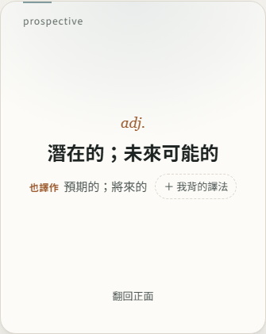

# 第 58 步：卡片背面的「也譯作」

## 目標

使用者發現有些字卡背面的意思和之前背的不一樣，例如 prospective 之前背「預期的」，卡片寫「潛在的；未來可能的」。兩個都對：多益 1000 單字包的中文是另外撰寫的「多益情境常用譯法」（多益常考 prospective clients＝潛在客戶），ECDICT 字典則寫「預期的；將來的」。問題不是內容錯，而是同一個意思有好幾種中文說法，看到不一樣的說法會以為是另一個意思。

## 先量化

用 1000 字比對單字包中文與 ECDICT：約 1/3 用字不完全相同。先試「自動顯示字典譯法」，但會有 362 張卡多一行，而且很多是字典的其他意思或舊用法（venue → 犯罪地點；審判地、download → 解除安裝），反而誤導。把三種做法給使用者選，使用者選了「人工整理」「一鍵加上我背的譯法」「AI 字卡也附其他譯法」。

## 做法

- **人工整理表**（`tools/pack-alt-meanings.tsv` → `tools/build_pack_alt.py` → `data/packs/toeic-1000-alt.json`）：逐字看字典主要釋義和卡片不同的 362 個字，只收「同一個意思、只是說法不同」且台灣教材常見的譯法，每字最多 3 個。工具會自動拿掉和卡片原本說法太像的詞（例如 接待員／接待人員），最後 307 個字有「也譯作」。
- **只顯示、不寫入**：整理表在畫到單字包字卡時才讀（約 10 KB），卡片背面主要意思下面多一行小字「也譯作：預期的；將來的」。不改已存的字卡，所以不用搬資料、也不會產生一堆同步。
- **一鍵加上我背的譯法**（`js/alt-meaning-ui.js`）：卡片背面的「＋ 我背的譯法」開小視窗，存成中文意思最後一行「也譯作：…」，保留原本顯示的譯法，標記為使用者修改（之後 AI 生成、單字包都不會蓋掉）。按鈕不會讓卡片翻回正面。
- **存法沿用中文欄位**：「也譯作」是中文意思的最後一行，備份、匯入、同步、衝突處理都不必改。`zhLines` 會略過這一行，所以單字庫列表、測驗選項仍以主要意思為主。
- **AI 生成**（`js/generate.js`）：同一次請求多要一個 `zhAlt`（同一個多益意思的其他常見說法，0～3 個），併進中文最後一行；和主要意思重複的會拿掉。不多花請求數。
- **比對規則**（`js/meaning-compare.js`，與 Python 版一致）：兩個說法「一個包含另一個」或「有兩個字連在一起相同」就算同一種，忽略「使」「的」和幾個異體字（污／汙、台／臺）。

## 遇到的問題與解法

- **卡片攔下點擊**：複習與自由翻卡的卡片會 `stopPropagation`，文件層級的點擊收不到「＋ 我背的譯法」。改在 `handleCardTap` 直接開視窗，單字探索（沒有翻卡處理）才用文件層級的事件。
- **單字包資料要按需載入**：一開始開站就讀整理表，`test_word_packs` 抓到違反「未開啟不下載單字包資料」。改成畫到單字包字卡才讀，讀完更新畫面上的那一行。
- **CSP 擋住測試的 `wait_for_function` 字串**：改用輪詢。

## 測試結果

- 單元測試 `tests/unit/meaning-compare.test.mjs`：拆詞、相似規則、合併與使用者優先、寫回中文；整理表每個字都在單字包裡、且不和卡片主要意思重複。
- 用 webapp-testing 新增 `tests/test_alt_meanings.py`（手機與桌機）：prospective 背面顯示「也譯作：預期的；將來的」；加上「有希望的」後中文變成 `潛在的；未來可能的\n也譯作：預期的；將來的；有希望的`、來源標記為使用者、卡片不翻面；單字探索看得到、列表第一行仍是主要意思；AI 生成（假回應）附上「房客；承租人」並拿掉重複的「租戶」。
- 重跑 `test_step1`、`test_free_cards`、`test_explore`、`test_word_packs`、`test_review_regressions`、`test_card_lookup_mode`、`test_step4`、`test_security`、`test_reverse_lookup` 都通過。

