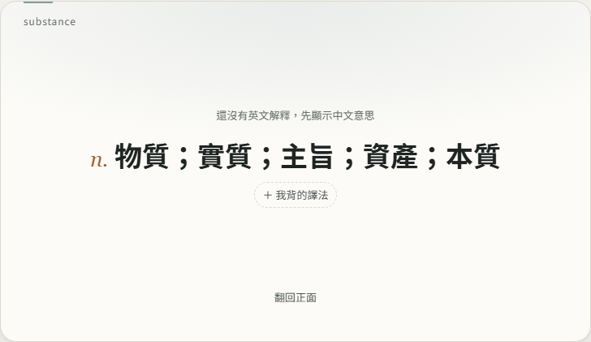

# 59. 點字收藏的字翻卡不再空白

## 目標
使用者回報：在解釋裡點 substance 收藏後，翻卡顯示「還沒有資料」，但編輯視窗裡明明有中文意思（n. 物質；實質…）；按儲存也沒有變化。

## 原因
1. **卡片是英文版**：英文版背面只看英文解釋，substance 只有中文、沒有英文，所以整張顯示「還沒有資料」。中文意思其實早就存好了，編輯儲存也有存，只是英文版不顯示中文。
2. **英文解釋沒有補查**：查單字視窗只有在使用者按「查英文」時才查 Free Dictionary；收藏時卻一律標成 `lookup.enDone: true`（已查過），背景的字典補查就把這個字跳過，英文解釋永遠是空的。

## 做法
- `js/cardview.js`：目前模式的內容還沒有、另一種有時，先顯示另一種並用小字註明（「還沒有英文解釋，先顯示中文意思」／反之亦然）。兩種都沒有才顯示「還沒有資料」。
- `js/word-lookup.js`：收藏時只有真的有英文解釋才標 `enDone`；沒有就收藏後立刻 `enqueueLookup` 在背景查 Free Dictionary（免費、不用 AI 額度）。
- 之前已收藏、被標成已查過的字不會自動重查；它們的英文版背面現在會先顯示中文，可在編輯補英文解釋。

## 遇到的問題
- 改了網站檔案沒重產 `sw.js` 發布清單，Service Worker 安裝失敗，`test_lookup_suggestions` 的瀏覽器直接當掉；跑 `tools/release_manifest.py` 後恢復。
- `test_inline_lookup` 原本規定收藏後完全不連外部 API；檢查的本意是「不用 AI 額度」，改成只檢查沒有呼叫 Gemini。

## 測試結果
`tests/test_lookup_saved_content.py`：英文版自由翻卡 → 點解釋裡的 substance 收藏 →
- 免費字典查不到：背面顯示註明＋中文意思，不是「還沒有資料」。
- 免費字典查得到：收藏後自動補上英文解釋，背面顯示英文。

